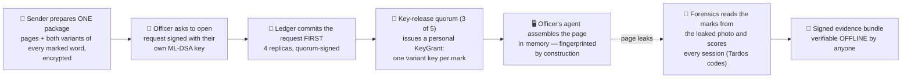
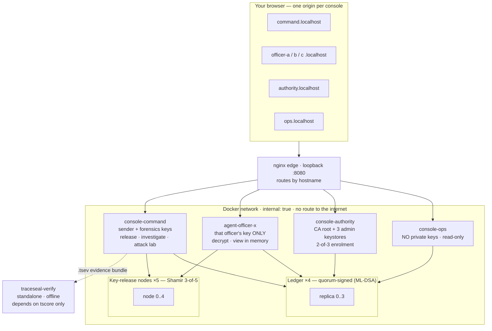
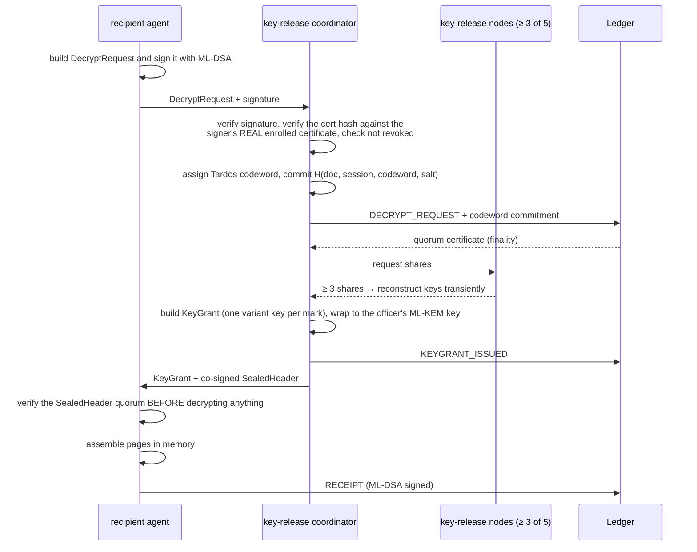

<div align="center">

# 🛡️ TraceSeal

### Nobody ever holds a clean copy.<br/>Every leak names exactly one person — and the proof verifies without trusting us.

**An offline, air-gapped platform for secure multi-recipient document distribution**<br/>
with post-quantum cryptography, per-decryption forensic fingerprints, and a tamper-evident ledger.


<a href="https://www.youtube.com/watch?v=b3i7tGGXObQ">
  
</a>

### ▶ [Watch the prototype demo on YouTube](https://www.youtube.com/watch?v=b3i7tGGXObQ)

*TraceSeal — Cryptographic Attribution & Immutable Decryption Provenance · SIH 26237 · Team Pixel Pioneers*

[The idea](#-the-idea-in-one-minute) · [Proof, not promises](#-proof-not-promises) · [Results](#-results) · [Architecture](#-architecture) · [Run it](#-run-it-in-10-minutes) · [Honest limitations](#-honest-limitations) · [Docs](#-documentation-map)

</div>

---

## 📌 The problem

When a classified document leaks, the question is **who**. Today's answers all fall short:

| Common approach | Why it fails the defence use case |
|---|---|
| Watermark the file *after* it's prepared | A clean copy existed first — and somebody had it |
| Log "Officer X opened it" in a database | An administrator can edit or delete the log |
| RSA / ECDSA signatures and key exchange | Classical public-key crypto is breakable by a future quantum computer |
| Cloud key management / public blockchain | Not acceptable on an air-gapped network |

TraceSeal is our answer to **Smart India Hackathon Problem Statement 26237** (Ministry of Defence — Indian Navy / WESEE).

## 💡 The idea in one minute

> **Decryption itself produces the fingerprint.** After the sender's preparation step, a clean, unmarked copy of the document **never exists anywhere** — not on the sender's machine, not on a server, not on an officer's disk.

The sender publishes **one** encrypted package that is identical for everyone. It contains each page *and both invisible variants of every marked word*. To read it, an officer must ask a quorum of independent key-release nodes. The quorum records the request on a tamper-evident ledger **first**, and only then hands that officer a personal key set that unlocks **exactly one variant per mark**. The copy is therefore marked **by construction** — and a modified client cannot produce an unmarked one.



**What you get**

- 🔍 **Attribution** — a leaked screenshot, photo or print-scan points to one decryption session, hence one officer.
- 🔒 **No clean copy, ever** — copies are visually identical but forensically distinct; plaintext lives only in memory.
- 📒 **An audit trail nobody can quietly rewrite** — every release, decrypt, enrolment and investigation is a signed, quorum-finalised ledger record.
- ⚛️ **Post-quantum by design** — NIST FIPS 203 / 204 / 205 primitives, nothing home-made.
- 🛰️ **Truly offline** — a Docker network with no route to the internet, proven live on screen.
- 🧪 **Evidence you don't have to trust us on** — a standalone verifier that needs no server, no ledger and no network.

---

## 🧪 Proof, not promises

Judges shouldn't have to take our word for anything. Every headline claim has a command that checks it against the running system.

| Claim | How it is checked | Command |
|---|---|---|
| **Air-gapped** — containers cannot reach the internet | Each of ~15 containers tries to open a connection to a public IP; none can | `python scripts/demo_isolation.py` |
| **Each officer is their own workstation** — one container, one set of keys | Mount audit of every container; each officer's filesystem is listed; officer A cannot read officer B's keystore | `python scripts/demo_isolation.py` |
| **Login is cryptographic** — a wrong passphrase *cannot* decrypt | Login *is* an Argon2id keystore unlock; one officer's session token is replayed against another → `401`/`403` | `python scripts/demo_isolation.py` |
| **Copies are forensically distinct** | Two officers decrypt the same document; their assembled pages differ | `python scripts/roles_e2e.py` |
| **Forwarding doesn't work** — a copy only opens for the person it was made for | Officer B presents officer A's copy → refused by the key-release quorum | `python scripts/roles_e2e.py` |
| **A leak is attributed to the right person** | A simulated phone photo of officer A's screen is investigated: A is accused, nobody else | `python scripts/roles_e2e.py` |
| **Evidence is verifiable without trusting the server** | The bundle is verified in a container with `--network none` | `python scripts/verify_offline.py <case.tsev>` |
| **Evidence can't be edited** | Flip one bit in the signed bundle → `INVALID: signature verification failed` | `python scripts/verify_offline.py <case.tsev>` |
| **No single node can release or block a document** | Kill one key-release node → still decrypts; kill three → refused (`need >= 3`) | `bash scripts/demo_actions.sh kill-node` / `kill-quorum` |
| **A compromised ledger replica is caught** | Overwrite a hash in one replica's database on disk → the others still agree, the liar is named | `bash scripts/demo_actions.sh tamper-ledger` |
| **No single admin can admit an officer** | Enrolment needs 2-of-3 admins, each typing *their own* passphrase | Authority console (see the demo script) |

> **Why the evidence verifier matters.** `traceseal-verify` depends on the `tscore` crypto package **only** — no ledger client, no CA, no forensics code. Its Dockerfile literally never copies them in. It re-checks every signature, ledger proof, commitment and Tardos score from the bundle alone.

---

## 📊 Results

### Live demo stack (measured on a laptop, Docker Desktop)

| | |
|---|---|
| Sample document | 5 pages · **245** marked word positions |
| Quality gate | whole-page SSIM **0.985** (release is *blocked*, not just flagged, if it drops below the bar) |
| Analyse + render both variants | ≈ 50 s (real image processing) |
| Release to two officers | ≈ 2 s |
| One officer's decrypt (quorum + in-memory assembly) | ≈ 3 s |
| Investigate a leaked photo | ≈ 2 s |
| Accusation reliability | **32 / 32** simulated captures correctly attributed, **0** wrongly accused (scores ≈ 34–39 against a threshold ≈ 27) |

### Attack lab — 180 real trials ([full table](docs/RESULTS.md))

Every trial renders a real page, applies a real distortion or collusion to the pixels, and runs the real `forensics.pipeline.investigate` — never simulated scoring. Document: 3 pages, 147 positions, 8 sessions, 5 trials per condition.

| Condition | Top-1 attribution | Innocent accusations |
|---|:---:|:---:|
| JPEG quality 30 | 100 % | 0 |
| Resize ×0.5 | 100 % | 0 |
| Crop 30 % | 100 % | 0 |
| Rotation ±3°, perspective warp | 100 % | 0 |
| Blur σ = 1.5 | 100 % | 0 |
| Simulated screen-camera / print-scan | 100 % | 0 |
| Collusion — majority / random / interleave, 2 colluders | 100 % | 0 |
| Collusion — patch averaging, 2–4 colluders | 100 % | 0 |
| **Crop 50 %** *(severe)* | **80 %** | 0 |
| **Collusion — interleave, 3 colluders** | **80 %** | 0 |
| **Collusion — minority, 4 colluders** *(hardest)* | **40 %** | 0 |

**Zero bit errors in every synthetic condition except the print-scan pipeline (0.98 % mean bit-error rate), and zero innocent accusations across all 180 trials — even where top-1 attribution itself degraded.** We show the weak rows on purpose: when evidence is thin the system reports *less certainty*, never a wrong name.

> ⚠️ **Honest scope:** these are *synthetic* distortions on a controlled document with 5 trials per condition — a benchmark, not a proof. No real phone photos have been evaluated yet (`attacklab/real/` ships empty, and `RESULTS.md` says so).

---

## 🏗️ Architecture

All components run as containers on a Docker network marked `internal: true` — **no route to the internet at runtime**. Only a loopback port on the web edge is published to the host.



| Component | Responsibility |
|---|---|
| `tscore` | The crypto core: ML-KEM, ML-DSA, SLH-DSA, AES-GCM, HKDF, Shamir, canonical CBOR, Tardos codes, the evidence bundle verifier |
| `ca` | Offline root CA (SLH-DSA); issues officer certificates through a 2-of-3 admin quorum |
| `sender` | Rasterises pages, selects mark positions, renders both variants, runs the quality gate, builds the broadcast package |
| `keyrelease` ×5 | Hold Shamir shares of the release keys; assign each session its Tardos codeword; issue `KeyGrant`s only **after** ledger finality |
| `ledger` ×4 | LedgerLite — hash-chained, quorum-signed replicas (a Hyperledger Fabric 3 SmartBFT backend is also built) |
| `agent` | The officer's recipient agent: signs requests, unwraps grants, assembles pages in memory, checks copy binding |
| `forensics` | Aligns a leaked image, reads each mark, runs Tardos accusation, builds the signed evidence bundle and PDF report |
| `verifier` | `traceseal-verify` — standalone, offline evidence checker |
| `attacklab` | Distortion + collusion benchmark harness |
| `web-api` / `web` | FastAPI role-scoped backends + the React console |

<details>
<summary><b>The decrypt session in detail</b> — commit before release (click to expand)</summary>



**Grant-before-finality is impossible** — it is directly tested, not just claimed (`keyrelease/tests/test_integration.py`). The full protocol and every sequence diagram are in [`docs/SPEC.md`](docs/SPEC.md) and [`docs/ARCHITECTURE.md`](docs/ARCHITECTURE.md).

</details>

### 🔐 Cryptography — standard primitives only, nothing invented

| Purpose | Primitive |
|---|---|
| Key wrapping (KEM-DEM) | **ML-KEM-768** (FIPS 203) → HKDF-SHA3-256 → AES-256-GCM |
| All operational signatures | **ML-DSA-65** (FIPS 204) |
| Offline root CA and ledger checkpoints | **SLH-DSA-SHA2-128s** (FIPS 205) |
| Payload encryption | AES-256-GCM, random 96-bit nonces, AAD always includes the header hash |
| Key derivation | HKDF-SHA3-256 with explicit, versioned `info` strings |
| Key custody | Shamir secret sharing, 3-of-5 across independent key-release nodes |
| Keystores at rest | Argon2id-derived key + AES-GCM |
| Signed structures | Canonical CBOR carrying `version`, `domain`, `nonce` (replay and cross-protocol protection) |
| Fingerprint code | Tardos codes — collusion-resistant, with a provable false-accusation bound |
| Implementation | `liboqs` (pinned upstream commit, built inside the image) + `cryptography` |

> **Residual trust assumption (stated, not hidden):** framing an *innocent* officer would require the sender **and** a threshold of key-release nodes to collude. Asymmetric fingerprinting is future work.

---

## 🖥️ The live demo: every officer is their own workstation

The console is split into **isolated consoles**, each its own browser origin backed by its own container that holds **only its own keys**:

| Console | URL | What it holds |
|---|---|---|
| **Command** — document owner | `command.localhost:8080` | sender + forensics keystores · release, investigate, attack lab |
| **Officer A / B** (C joins live) | `officer-a.localhost:8080` … | only that officer's keystore · decrypt and view |
| **Authority** | `authority.localhost:8080` | CA root + 3 admin keystores · two-person enrolment |
| **Operations** | `ops.localhost:8080` | **nothing** — read-only ledger and system view |

- **Real login** — the passphrase *is* the keystore decryption key (Argon2id). Sessions are 256-bit random tokens, stored hashed, `HttpOnly` + `SameSite=Strict`, with an idle auto-lock that wipes decrypted pages.
- **A new officer joins live** — their workstation starts, they request enrolment from their *own* console, and **two administrators each type their own passphrase** to admit them.
- **The leak travels as a file** — the investigator cannot read an officer's screen, so a simulated photo is handed over exactly like a real leak would be.

📜 **The 9-minute judge script** — word for word, with measured timings, Q&A and recovery steps: [`docs/JUDGE_DEMO_SCRIPT_ROLES_9MIN.md`](docs/JUDGE_DEMO_SCRIPT_ROLES_9MIN.md) · how it's built: [`docs/ROLES_DEMO.md`](docs/ROLES_DEMO.md)

> **Be precise about what "isolated" means.** These are separate containers with disjoint key material on **one host** — not separate physical machines. A compromise of the Docker host defeats it. See [`docs/THREAT_MODEL.md`](docs/THREAT_MODEL.md) ("Role isolation").

---

## 🚀 Run it in 10 minutes

**Prerequisites:** Docker (Desktop on Windows/macOS), Python 3 on the host (standard library only, for the proof scripts), and on Windows use **Git Bash** — not PowerShell, where `bash` is the WSL launcher.

```bash
git clone <this repository>
cd TraceSeal

bash scripts/roles.sh provision   # seeds PKI, builds images, distributes keys, enrols officers A and B
bash scripts/roles.sh up          # starts every console
```

> The first run compiles `liboqs` from a pinned commit inside the image, so expect several minutes. Everything after that is cached.

Then open **http://localhost:8080** for the console launcher, or go straight to the consoles above. Passphrases are generated per identity into `demo/roles/CREDENTIALS.local.txt` (gitignored, never committed).

```bash
python scripts/demo_isolation.py       # live probes: mounts, filesystems, egress, session replay
python scripts/roles_e2e.py            # whole scenario: release → decrypt → forward → leak → accuse → verify offline
bash scripts/demo_actions.sh status    # stage helpers: kill-node · tamper-ledger · start-officer-c …
bash scripts/roles.sh provision        # RESET to a clean demo state (also rotates every passphrase)
```

If `*.localhost` doesn't resolve on your machine, add `127.0.0.1 command.localhost officer-a.localhost officer-b.localhost officer-c.localhost authority.localhost ops.localhost` to your hosts file.

<details>
<summary><b>Run the test suites and per-milestone demos</b></summary>

```bash
make up          # build + start all containers on the internal-only network
make test        # every package's unit tests + the no-egress proof
make test-tardos-sim  # the slower Tardos Monte-Carlo suite
make lint        # ruff + mypy over every package
make demo-m0     # M0 acceptance checks + summary
make demo-m1     # M1 acceptance checks + summary; writes demo/out/m1/
make demo-m2     # M2 acceptance checks + summary; writes demo/out/m2/
make e2e         # M3 acceptance: full protocol distribution + decrypt (== make demo-m3)
make demo-m4     # M4 acceptance: enrolment quorum, revocation, copy binding, forwarding detection
make demo-m5     # M5 acceptance: evidence bundle + standalone verifier + signed PDF report
make demo-m6     # M6 acceptance: Fabric 3 SmartBFT ledger backend, full protocol re-run against it
make demo-m7     # M7 acceptance: attack lab (distortion + collusion), writes docs/RESULTS.md
```

Targets for the isolated deployment: `make roles-provision`, `make roles-up`, `make roles-down`, `make demo-isolation`, `make roles-e2e`.

Requires Docker. `liboqs` is built from a pinned upstream commit inside the `tscore` image (see `packages/tscore/Dockerfile` and `docs/DECISIONS.md` ADR-0003), so no host toolchain is required for any image.

No GNU Make on your machine (typical on Windows)? The equivalent plain commands:

```bash
docker compose build
docker compose run --rm tscore python -m pytest -q -m "not slow" packages/tscore/tests
docker compose run --rm tscore python -m pytest -q -m slow packages/tscore/tests/test_tardos.py
docker compose run --rm tscore python -m pytest -q tests/integration
docker compose run --rm sender python -m pytest -q packages/sender/tests
docker compose run --rm sender python -m sender.demo_m1
docker compose run --rm forensics python -m pytest -q packages/forensics/tests
docker compose run --rm forensics python -m forensics.demo_m2
docker compose run --rm ca python -m pytest -q packages/ca/tests
docker compose run --rm ledger-0 python -m pytest -q packages/ledger/tests
docker compose run --rm keyrelease-0 python -m pytest -q packages/keyrelease/tests
docker compose run --rm agent python -m pytest -q packages/agent/tests
docker compose run --rm verifier python -m pytest -q packages/verifier/tests
docker compose run --rm tscore sh -c "ruff check packages/tscore/src packages/tscore/tests && cd packages/tscore && mypy"
docker compose run --rm sender sh -c "ruff check packages/sender/src packages/sender/tests && cd packages/sender && mypy"
docker compose run --rm forensics sh -c "ruff check packages/forensics/src packages/forensics/tests && cd packages/forensics && mypy"
docker compose run --rm ca sh -c "ruff check packages/ca/src packages/ca/tests && cd packages/ca && mypy"
docker compose run --rm ledger-0 sh -c "ruff check packages/ledger/src packages/ledger/tests && cd packages/ledger && mypy"
docker compose run --rm keyrelease-0 sh -c "ruff check packages/keyrelease/src packages/keyrelease/tests && cd packages/keyrelease && mypy"
docker compose run --rm agent sh -c "ruff check packages/agent/src packages/agent/tests && cd packages/agent && mypy"
docker compose run --rm verifier sh -c "ruff check packages/verifier/src packages/verifier/tests && cd packages/verifier && mypy"

# M3/M4 end-to-end (see the `e2e`/`demo-m4` targets in the Makefile for
# the exact steps — enrolment is now a hard prerequisite, ADR-0020):
docker compose run --rm ca
docker compose up -d ledger-0 ledger-1 ledger-2 ledger-3 \
    keyrelease-0 keyrelease-1 keyrelease-2 keyrelease-3 keyrelease-4
docker compose run --rm ca python -m ca.demo_m4              # real 2-of-3 admin quorum enrols every officer
docker compose run --rm sender python -m sender.demo_m3
docker compose run --rm agent python -m agent.demo_m3 --officer a   # repeat for b, c, d, e
docker compose run --rm ca python -m ca.demo_m4 --revoke officer-e  # then officer-e's decrypt is denied
docker compose run --rm agent python -m agent.demo_m4 \
    --officer d --claim-cert-of officer-c --doc-id doc-m3-demo       # forwarding-detection demo
docker compose down

# M5: evidence bundle + standalone verifier (see the `demo-m5` target in
# the Makefile for the exact steps — runs its own document registration
# and decrypt session, so only needs a seeded, enrolled PKI + live cluster):
docker compose run --rm ca
docker compose up -d ledger-0 ledger-1 ledger-2 ledger-3 \
    keyrelease-0 keyrelease-1 keyrelease-2 keyrelease-3 keyrelease-4
docker compose run --rm ca python -m ca.demo_m4
docker compose run --rm forensics python -m forensics.demo_m5
docker compose run --rm verifier traceseal-verify demo/out/m5/case.tsev        # -> VALID, exit 0
docker compose run --rm forensics python -m forensics.tamper_demo
docker compose run --rm verifier traceseal-verify demo/out/m5/case_tampered.tsev  # -> INVALID, exit 1
docker compose down

# M6: Fabric 3 SmartBFT ledger backend (see the `demo-m6` target in the
# Makefile for the exact steps — brings up its own 4-org network, channel,
# and chaincode from scratch):
make demo-m6

# M7: attack lab (see the `demo-m7` target in the Makefile — runs entirely
# in-process, no live cluster needed):
make demo-m7
```

</details>

---

## ✅ Requirements coverage

Every requirement from the problem statement is traced to code and tests in [`docs/REQUIREMENTS_TRACE.md`](docs/REQUIREMENTS_TRACE.md).

| ID | Requirement | Status |
|---|---|---|
| R1 | Invisible forensic watermark generated **at the moment of decryption** | ✅ Verified end-to-end |
| R2 | Specific to each recipient **and** each session | ✅ Verified end-to-end |
| R3 | Copies visually identical, forensically distinct | ✅ Verified end-to-end |
| R4 | Decryption event bound to the recipient's identity | ✅ Verified end-to-end |
| R5 | Decryption record signed with the recipient's **own** key | ✅ Verified end-to-end |
| R6 | NIST PQC (ML-KEM, ML-DSA, SLH-DSA) | ✅ Wired into the real protocol |
| R7 | Immutable audit layer on a ledger / DLT | ✅ LedgerLite **and** Fabric 3 SmartBFT |
| R8 | No single admin or compromised account can alter or delete audit records | ✅ Quorum finality; 2-of-3 enrolment; tamper detection demonstrated |
| R9 | Extract the watermark from a leaked copy | ✅ Clean screenshots and a synthetic-distortion suite · ◐ real phone photos not yet evaluated |
| R10 | Look up the watermark against the ledger | ✅ Verified end-to-end |
| R11 | Cryptographically verifiable record identifying the recipient | ✅ Signed bundle + standalone offline verifier |
| R12 | Fully offline, air-gapped | ✅ Live egress probes |
| R13 | No cloud KMS dependency | ✅ Local liboqs / `cryptography` only |
| R14 | No public blockchain dependency | ✅ Self-hosted ledgers only |
| G1 | Copies bound to the owner; forwarded copies denied | ✅ Verified end-to-end |
| G2 | Attribution survives screenshot / JPEG / crop / photo / print-scan | ✅ Synthetic distortions · ◐ real captures pending |
| G3 | Collusion-resistant with a provable false-accusation bound | ✅ Library-verified and real-pixel-verified |
| G4 | Standalone verifier needs no trust in the server | ✅ Verified end-to-end |
| G5 | No single admin can enrol a ghost identity or swap keys | ✅ Verified end-to-end |

---

## ⚠️ Honest limitations

In a security product, what you *don't* claim is part of the product. The short version — the [full register](#-complete-limitations-register) follows:

- **One host, not many machines.** The isolated consoles are separate containers with disjoint keys on a single Docker host.
- **LedgerLite is a stand-in.** It is a real, working, quorum-signed 4-replica ledger — not a mock — and it is labelled as such everywhere. A Hyperledger Fabric 3 SmartBFT backend with a post-quantum-verifying chaincode is built and verified, but **Fabric's own peer/orderer transport stays classical (ECDSA/TLS)**. We never claim Fabric is post-quantum end to end.
- **Synthetic captures only.** Attribution has been benchmarked on synthetic distortions; no real phone photos or scans have been evaluated, and there is no page-detection step for a photographed page.
- **One variant only.** Only the micro-shift variant is implemented and evaluated.
- **Passphrases are demo-grade** (four words, Argon2id-slowed) and sessions live in memory — not a production credential policy.
- **A statistical conclusion, not a verdict.** Reports say "suitable for investigative and evidentiary review". We make **no claim of legal admissibility**, and **no claim of protection against retyping or reading a document aloud**.
- **Demo content is synthetic** — synthetic documents, synthetic officers.

---

## 📚 Documentation map

| Document | What's in it |
|---|---|
| [`docs/JUDGE_DEMO_SCRIPT_ROLES_9MIN.md`](docs/JUDGE_DEMO_SCRIPT_ROLES_9MIN.md) | **Start here for the demo** — timed 9-minute script, Q&A, recovery |
| [`docs/SPEC.md`](docs/SPEC.md) | The master build specification: requirements, protocol, milestones |
| [`docs/ARCHITECTURE.md`](docs/ARCHITECTURE.md) | Component diagram and every protocol sequence diagram |
| [`docs/THREAT_MODEL.md`](docs/THREAT_MODEL.md) | STRIDE analysis, role-isolation threats, residual risks |
| [`docs/REQUIREMENTS_TRACE.md`](docs/REQUIREMENTS_TRACE.md) | Each requirement → code → tests |
| [`docs/RESULTS.md`](docs/RESULTS.md) | The full attack-lab benchmark (generated, never hand-edited) |
| [`docs/DECISIONS.md`](docs/DECISIONS.md) | Every architecture decision record (ADR-0001 … ADR-0058) |
| [`docs/ROLES_DEMO.md`](docs/ROLES_DEMO.md) | How the isolated-roles deployment is built and run |
| [`docs/superpowers/`](docs/superpowers/) | Design spec and implementation plan for role isolation |

## 🗂️ Repository map

```text
packages/
  tscore/        crypto core — KEM, signatures, Shamir, CBOR, Tardos, evidence verification
  ca/            offline root CA + enrolment quorum ceremony
  sender/        rasteriser, mark selection, variants, quality gate, broadcast package
  keyrelease/    5 key-release nodes (Shamir shares, KeyGrants, SealedHeaders)
  ledger/        LedgerLite replicas + the pluggable LedgerBackend (Fabric target)
  agent/         recipient agent: keystore, decrypt, copy binding; role provisioning
  forensics/     alignment, per-position detection, Tardos accusation, evidence bundle
  verifier/      traceseal-verify — standalone offline evidence checker
  attacklab/     distortion + collusion benchmark harness
  web-api/       FastAPI backends, run as role-scoped consoles
  fabric-gateway/ REST relay to the Fabric network
chaincode/traceseal/   Go chaincode: ML-DSA / SLH-DSA verification (Cloudflare CIRCL)
fabric-network/        4-org Hyperledger Fabric 3 SmartBFT network
web/                   React 18 + TypeScript (strict) + Vite + Tailwind console
scripts/               roles.sh · demo_isolation.py · roles_e2e.py · demo_actions.sh · verify_offline.py
docs/                  spec, architecture, threat model, results, ADRs, demo scripts
tests/                 integration tests (incl. the no-egress proof)
```

**Built with:** Python 3.12 · FastAPI · Pydantic v2 · `liboqs` · `cryptography` · PyMuPDF · OpenCV · NumPy / SciPy / scikit-image · React 18 · TypeScript · Vite · Tailwind · TanStack Query · Zustand · Recharts · Docker Compose · Hyperledger Fabric 3.x · Go + Cloudflare CIRCL.

---

## 🧭 Milestones

| | Milestone | Status |
|---|---|---|
| M0 | Skeleton, Compose, crypto core | ✅ |
| M1 | Variant / watermark engine, quality gate, Tardos library | ✅ |
| M2 | Forensics on clean screenshots | ✅ |
| M3 | Full protocol end-to-end on LedgerLite | ✅ |
| M4 | Enrolment quorum, revocation, copy binding | ✅ |
| M5 | Evidence bundle, standalone verifier, signed PDF report | ✅ |
| M6 | Hyperledger Fabric 3 SmartBFT backend | ✅ |
| M7 | Attack lab: distortions and collusion | ✅ |
| M8 | Web console, demo script, threat model | ✅ |
| + | Isolated roles: per-identity login, key vaults, two-person enrolment | ✅ |

<details>
<summary><b>Milestone-by-milestone verification log (M0 – M7)</b> — what each acceptance run actually did</summary>

**M0** (crypto/schema core), **M1** (variant/watermark engine, quality
gate, Tardos library), **M2** (forensics on clean screenshots), **M3**
(full crypto protocol: sender, 5 key-release nodes, a 4-replica ledger, the
recipient agent, commit-before-release, receipts), **M4** (enrolment
quorum, revocation, copy binding, forwarding detection), **M5** (evidence
bundle, standalone verifier, signed PDF report), **M6** (Fabric 3 SmartBFT
ledger backend), and **M7** (attack lab: distortion + collusion harness)
are all done. All acceptance criteria pass for real, in Docker:

- `packages/tscore`: 88 fast unit tests + the 6-strategy Tardos
  Monte-Carlo suite, against a real liboqs 0.16.0 build — including
  `tscore.evidence`'s full genuine-bundle-plus-6-tampering-case suite,
  the single cryptographic re-verification core `forensics` (builder) and
  `verifier` (checker) both call.
- The no-egress proof: DNS resolution and outbound TCP both fail from
  inside the `internal: true` network.
- `packages/sender`: 21 unit tests, plus `make demo-m1` — a synthetic
  3-page document, 147 real mark positions, 5 assembled per-session
  copies, quality gate PASS (whole-page SSIM ≥ 0.98).
- `packages/forensics`: 16 unit tests (11 from M2 plus 5 new M5
  investigation-pipeline tests, wired against a real in-process ledger +
  key-release cluster), plus `make demo-m2` — 5/5 leaked sessions
  correctly attributed from a simulated rescaled screenshot, 0 innocent
  accusations, via real ORB/RANSAC image registration and per-position
  correlation detection (not a lookup or a mock).
- `packages/ca`, `packages/ledger`, `packages/keyrelease`, `packages/agent`:
  16 + 20 + 11 + 9 unit tests, plus `make e2e`/`make demo-m4` — a real
  9-container run (4 ledger replicas, 5 key-release nodes) where every
  officer is admitted through a genuine 2-of-3 admin quorum ceremony (no
  seed-script shortcut), the sender registers and distributes an encrypted
  document, and each officer independently runs a real decrypt session: a
  signed `DecryptRequest` cross-checked against that officer's real
  enrolled certificate, a ledger-finalized commitment, a quorum-issued
  `KeyGrant` plus a co-signed `SealedHeader`, an in-memory-only assembled
  copy, and a finalized `Receipt` — all real ML-KEM-768/ML-DSA-65, no
  mocked verification anywhere in that path. Revoking an officer's
  certificate and re-attempting a decrypt is denied server-side; an
  officer self-declaring a different officer's identity is denied both
  server-side and by the agent's own independent `SealedHeader` quorum
  check. The key-release layer's "grant-before-finality is impossible"
  property is directly tested, not just claimed
  (`keyrelease.tests.test_integration`).
- `packages/verifier`: 5 unit tests, plus `make demo-m5` — a real
  9-container run where `forensics` opens an investigation on the ledger,
  reveals the leaking session's codeword from the key-release vault
  (cross-checked against the ledger's own commitment before being
  trusted), independently re-derives the Tardos score, and builds,
  self-checks, signs, and writes a genuine `EvidenceBundle` plus a signed
  PDF report (with a mandatory limitations section) as `case.tsev`. The
  standalone `traceseal-verify` CLI — a package that depends on
  `packages/tscore` **only** (no `ledger`/`ca`/`forensics`/`sender`
  import anywhere, enforced literally by its Dockerfile never copying
  them in, and confirmed directly: `python -c "import pkgutil; ..."`
  inside that image lists only `tscore` and `verifier`) — independently
  re-verifies the genuine bundle as **VALID (exit 0)**, then a
  one-byte-tampered copy as **INVALID (exit 1)**. This is the M5
  acceptance criterion, demonstrated against a live cluster, not a
  simulated or hand-waved pass.
- `make demo-m6` — a real 4-organization Hyperledger Fabric 3.1.5 network
  (4 independent orderer MSPs running SmartBFT consensus, 4 peer MSPs, no
  system channel — Fabric 3.x's Channel Participation API bootstrap
  instead) running a real Go chaincode (`chaincode/traceseal`) that
  verifies ML-DSA-65 and SLH-DSA-SHA2-128s signatures via Cloudflare
  CIRCL, confirmed to genuinely interoperate with `liboqs`-produced
  signatures (`chaincode/traceseal/interop_test.go`, including
  tampered-signature negative cases for both algorithms). The identical
  M3/M4 protocol scenario — enrolment, document registration, and all 5
  officers' decrypt sessions — ran against this network end-to-end via
  `LEDGER_BACKEND=fabric`, with zero protocol-level code changes outside
  the ledger-client construction sites (`ledger.backend.build_ledger_client`).
  A real ≥3-of-4 ML-DSA validator co-signing pass and a signed SLH-DSA
  checkpoint export both ran for real. LedgerLite remains the default
  backend everywhere else, and its own test suites are unaffected by the
  backend refactor (still green).
- `make demo-m7` — every spec Section 15 synthetic distortion (JPEG q in
  {90,70,50,30}, resize x{0.75,0.5}, crop {10,30,50}%, rotation
  ±{1,3}°, perspective warp, blur σ in {0.5,1,1.5}, noise, brightness/
  contrast, a simulated screen-camera pipeline, a simulated print-scan
  pipeline) and every collusion condition (majority/minority/random/
  interleave/patch-averaging for c in {2,3,4}) ran as real trials — real
  rendered pages, real distorted/colluded pixels, real
  `forensics.pipeline.investigate` calls, never simulated — against a
  real 3-page/147-position document and 8 sessions. Results:
  **zero bit errors and 100% top-1 accuracy** across every mild-to-
  moderate condition; graceful, honestly-reported degradation under
  severe conditions (50% crop, blur σ=1.5, heavy collusion); **zero
  innocent accusations across all 180 real trials**, even where top-1
  attribution itself degraded. Full numbers in
  [`docs/RESULTS.md`](docs/RESULTS.md). `attacklab/real/` (real phone-
  photo/scan captures) ships empty — reported honestly, not hidden — and
  only variant A is evaluated; see that section below.

**Not yet implemented:** the UI Investigate flow with Evidence Graph
(deferred to M8, same demo-script substitution used for M4's
`OPEN_DENIED` — M5's own acceptance criterion names only the
verifier/bundle chain), the PQC BCCSP fork for Fabric's own internal
transport (a stated stretch goal — Fabric's peer/orderer transport stays
ECDSA; evidentiary verification depends only on the chaincode-verified
PQC signatures and the co-signing layer, never on Fabric's transport
crypto), variants B/C (glyph micro-scale, stroke-weight — never built,
see `docs/DECISIONS.md` ADR-0041), real-capture robustness (no phone-
photo/scan data, no page-detection step for a photographed page — ADR-
0043), and UI polish. See [`docs/SPEC.md`](docs/SPEC.md) Section 17 for
the full milestone plan and
[`docs/REQUIREMENTS_TRACE.md`](docs/REQUIREMENTS_TRACE.md) for
per-requirement status.

</details>

<details id="-complete-limitations-register">
<summary><b>Complete limitations register</b></summary>

- Enrolment applies to *officers* only — infrastructure identities (the CA
  root, 4 ledger replicas, 5 key-release nodes, the sender, and the 3 admin
  identities themselves) are still bootstrap-seeded directly by `ca.seed`,
  deliberately out of scope (ADR-0019): some initial trust anchor has to
  exist before any ceremony can run, and the spec's own demo script frames
  enrolment specifically around admitting officers, not the system's own
  components.
- Only certificate *revocation* is implemented, matching what the spec
  actually asks for — there is no certificate expiry.
- `LedgerLite` is a real, working, quorum-signed 4-replica ledger — not a
  mock — and remains the default backend. Hyperledger Fabric with SmartBFT
  and a PQC-verifying chaincode (spec Section 12) is now implemented and
  verified (M6, `LEDGER_BACKEND=fabric`), but Fabric's own internal
  transport (peer gossip, orderer block signing) stays ECDSA — the PQC
  BCCSP fork is a stated stretch goal, not built. Nothing here claims
  Fabric's transport layer itself is post-quantum; evidentiary
  verification depends only on the chaincode-verified ML-DSA/SLH-DSA
  signatures and the post-hoc ML-DSA co-signing pass.
- The Fabric SLH-DSA checkpoint (`ledger.checkpoint`) signs a manifest
  hash over whatever records are queryable at export time, not a running
  Merkle accumulator over history — the same "no Merkle tree" honesty
  scoping as LedgerLite's own inclusion proofs (ADR-0027, ADR-0038). Its
  QR export carries a compact fingerprint (manifest hash + metadata), not
  the full signed checkpoint — an SLH-DSA-SHA2-128s signature doesn't fit
  in any QR code version — so the QR is a manual cross-check pointer
  against the JSON file, not a self-contained verifiable artifact.
- The attack lab (M7) evaluates only variant A (micro-shift) — variants B
  (glyph micro-scale) and C (stroke-weight) were never built, despite spec
  Section 9 naming them as "behind flags and evaluated in the attack lab"
  (ADR-0041). It also has no page-detection/perspective-correction step
  for separating a photographed page from its background (spec Section 11
  step 2), so `attacklab/real/` — the real phone-photo/scan folder — ships
  empty and is reported as such in `docs/RESULTS.md`, not hidden or faked
  (ADR-0043). The micro-shift δ and Tardos threshold constant `k` were
  reviewed against this milestone's real data and left unchanged — the
  data showed no bit errors or excess false accusations at either mild or
  severe distortion strengths, so there was no evidence to justify moving
  either (ADR-0044).
- The evidence bundle's ledger inclusion proofs (M5) demonstrate a
  record's own internal hash-chain consistency and genuine quorum
  sign-off — LedgerLite (ADR-0012) has no Merkle/checkpoint structure, so
  this does NOT prove a record wasn't omitted from a longer chain never
  independently walked end-to-end (ADR-0027; stated in every signed PDF
  report's mandatory limitations section, not hidden).
- The UI Investigate flow with Evidence Graph is deferred to M8 (same
  demo-script substitution already used for M4's `OPEN_DENIED`) — M5's
  data (scores, proofs, the full candidate-session histogram) all exist
  and are in the bundle; only the graph rendering is missing.
- The KEM/signature/protocol tests require a working liboqs build. They're
  verified to pass inside the pinned Docker images (`make test`, `make
  e2e`, `make demo-m4`, `make demo-m5`); on a host without Docker or a C
  toolchain for liboqs, those specific tests are skipped rather than faked
  (see each package's `tests/conftest.py`).
- Several parameters were tuned empirically against the real demo
  document, not assumed from the spec's starting values — the quality
  gate's SSIM threshold and the micro-shift `delta_px` (ADR-0006 through
  ADR-0008), and the forensic pipeline's registration/detection approach
  itself, which went through two rejected designs before landing on one
  that measured correctly (ADR-0009, ADR-0010). The M3 demo document (147
  mark positions) also can't support the naive n=5/c0=3/eps1=1e-4 Tardos
  target — `sender.demo_m3` reports this degradation honestly rather than
  hiding it (same pattern as `make demo-m1`). A much larger, differently
  formatted, or genuinely distorted (photo/scan) real document may need
  further tuning; M7's attack lab is where that gets evaluated
  systematically.
- "Milestone acceptance" through M5 is crypto/protocol/image-pipeline/
  forensics/evidence-chain correctness against controlled, undistorted
  inputs — not yet a working product with a UI, and not yet tested against
  anything but a clean, synthetic, single-document scenario with no
  adversarial behaviour beyond the specific negative cases M4/M5 exercise
  (a revoked certificate, a self-declared identity mismatch, a tampered
  evidence bundle) — real-world adversarial robustness is M7's attack lab.
  Do not read `make demo-m0`..`m5`/`make e2e` passing as a claim that
  TraceSeal protects or can trace a real, arbitrarily-leaked document
  under adversarial conditions yet.
- This project makes no claim of legal admissibility, no claim of
  protection against retyping/reading a document aloud, and does not claim
  Fabric is PQC end-to-end unless the BCCSP fork described in the spec is
  actually built (M6). Demo content is always synthetic.

</details>

---

<div align="center">

**TraceSeal** · Smart India Hackathon 2026 · Problem Statement 26237<br/>
Ministry of Defence — Indian Navy / WESEE · Team **Pixel Pioneers**

▶ [Watch the demo](https://www.youtube.com/watch?v=b3i7tGGXObQ)

*Correctness and honesty matter more than visual flash.*

</div>
