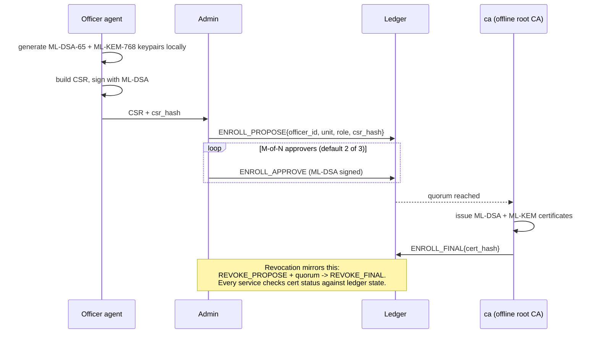
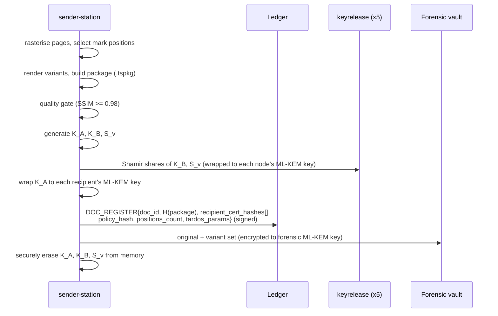
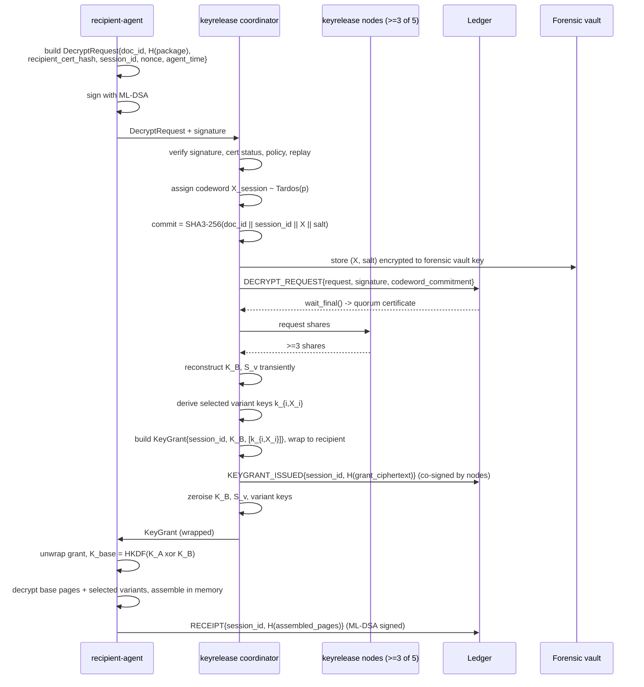
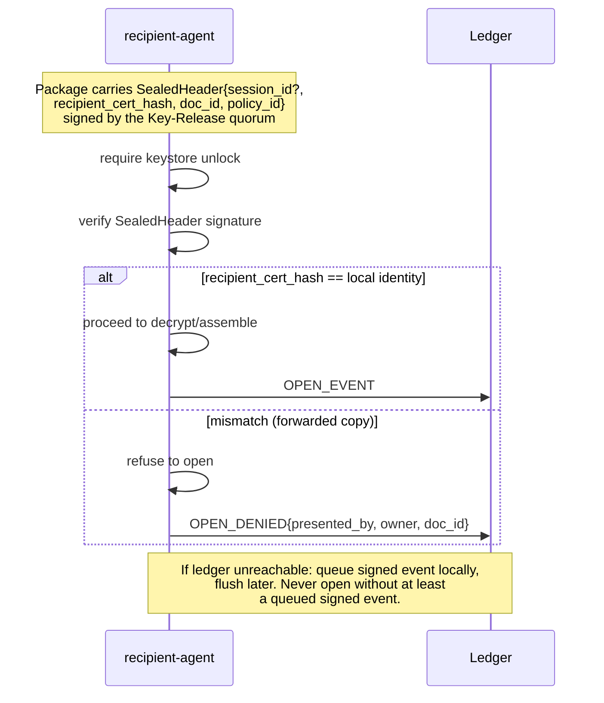
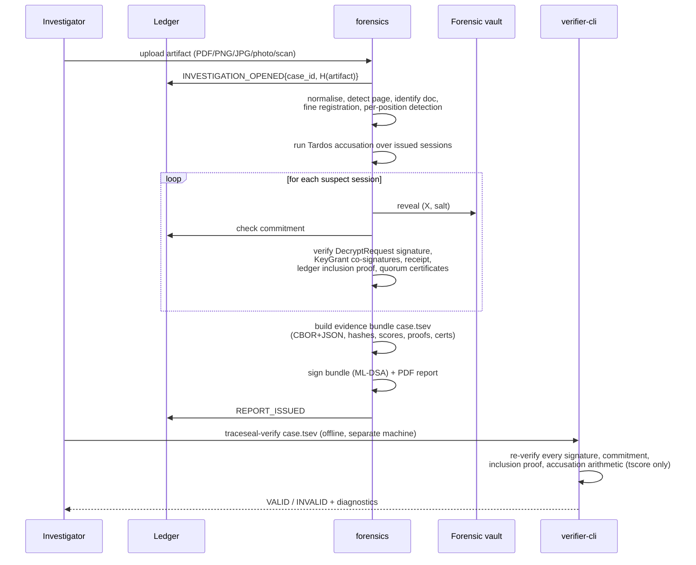

# TraceSeal — Architecture

Companion to [`SPEC.md`](SPEC.md). This file holds the component diagram and
the protocol sequence diagrams referenced from Spec Section 7. Diagrams are
Mermaid; render with any Mermaid-aware viewer (GitHub, VS Code extension, or
`mmdc`).

## Component diagram

All components run as containers on a single Docker network with
`internal: true` — no egress to the public internet at runtime. Only the
`web` UI and each `recipient-agent` are reachable from a browser, and only on
localhost/LAN.

```mermaid
flowchart TB
    subgraph internal["Internal Docker network (internal: true — no egress)"]
        CA["ca<br/>offline root CA (SLH-DSA)<br/>issues ML-DSA / ML-KEM certs"]

        SENDER["sender-station<br/>rasterise · mark positions · variants<br/>package · quality gate · K_A wrap"]

        subgraph KR["keyrelease (x5, independent authorities)"]
            KR1["node 1"]
            KR2["node 2"]
            KR3["node 3"]
            KR4["node 4"]
            KR5["node 5"]
        end

        subgraph LEDGER["ledger (LedgerBackend)"]
            LL["LedgerLite<br/>4 replicas, ML-DSA 3-of-4 quorum"]
            FAB["Fabric 3 SmartBFT<br/>(M6 target)<br/>Go chaincode, ML-DSA verify"]
        end

        FORENSICS["forensics<br/>artifact intake · alignment<br/>per-position detection · Tardos accusation"]

        VERIFIER["verifier-cli<br/>standalone, offline<br/>depends only on tscore"]

        ATTACKLAB["attack-lab<br/>distortion + collusion harness"]

        PG[(PostgreSQL 16<br/>metadata)]
        BLOB[(Blob store<br/>ciphertext only)]
        VAULT[("Forensic vault<br/>originals + both variants<br/>encrypted to forensic ML-KEM key")]

        subgraph AGENTS["recipient-agent (one per officer workstation)"]
            AG_A["Officer A agent<br/>+ keystore"]
            AG_B["Officer B agent<br/>+ keystore"]
            AG_DOTS["... officers C-E"]
        end

        WEB["web<br/>React UI: Command Center, Distribute,<br/>Monitor, Investigate, Ledger, Identity, Attack Lab"]
    end

    ADMIN(["Admin / approvers"])
    OFFICER(["Officer (browser, localhost)"])
    INVESTIGATOR(["Investigator"])

    ADMIN -->|enrolment proposals/approvals| WEB
    WEB --> CA
    WEB --> SENDER
    WEB --> FORENSICS
    WEB --> LEDGER
    WEB --> ATTACKLAB

    CA -->|reads quorum state| LEDGER
    SENDER -->|DOC_REGISTER| LEDGER
    SENDER -->|Shamir shares of K_B, S_v<br/>wrapped per node| KR
    SENDER --> BLOB
    SENDER -->|originals + variants| VAULT

    OFFICER -->|unlock, view| AGENTS
    AGENTS -->|DecryptRequest signed ML-DSA| KR
    KR -->|DECRYPT_REQUEST, KEYGRANT_ISSUED| LEDGER
    KR -->|KeyGrant wrapped to recipient| AGENTS
    AGENTS -->|RECEIPT signed| LEDGER
    AGENTS -->|fetch base+variant ciphertext| BLOB

    INVESTIGATOR -->|upload artifact| WEB
    WEB --> FORENSICS
    FORENSICS -->|reveal (X, salt), verify commitments| VAULT
    FORENSICS -->|read sessions, proofs| LEDGER
    FORENSICS -->|case.tsev + signed report| VERIFIER

    LL -.->|target impl swap, same LedgerBackend interface| FAB
```

---

## Protocol sequence diagrams (Spec Section 7)

### 7.1 Enrolment (G5)



### 7.2 Document registration and distribution



### 7.3 Decryption session (R1-R5, commit-before-release)



### 7.4 Copy binding and open events (G1)



### 7.5 Investigation (R9-R11)


