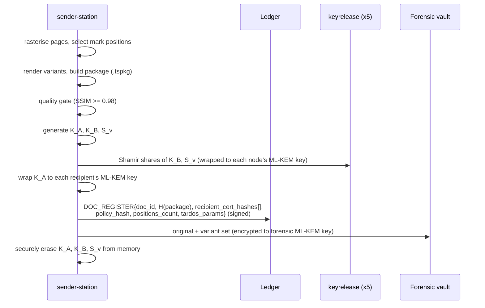
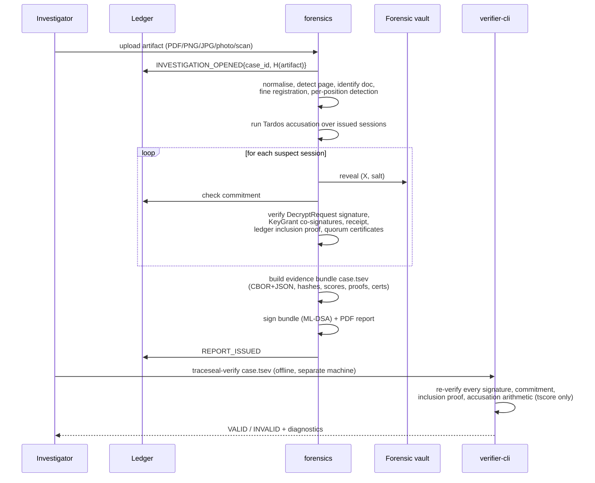

# TraceSeal — Architecture

Companion to [`SPEC.md`](SPEC.md). This file holds the component diagram and
the protocol sequence diagrams referenced from Spec Section 7. Diagrams are
Mermaid; render with any Mermaid-aware viewer (GitHub, VS Code extension, or
`mmdc`).

## Component diagram

All components run as containers on a single Docker network with
`internal: true` — no egress to the public internet at runtime. Only the
`web` UI and each `recipient-agent` are reachable from a browser, and only on
localhost/LAN.

```mermaid
flowchart TB
    subgraph internal["Internal Docker network (internal: true — no egress)"]
        CA["ca<br/>offline root CA (SLH-DSA)<br/>issues ML-DSA / ML-KEM certs"]

        SENDER["sender-station<br/>rasterise · mark positions · variants<br/>package · quality gate · K_A wrap"]

        subgraph KR["keyrelease (x5, independent authorities)"]
            KR1["node 1"]
            KR2["node 2"]
            KR3["node 3"]
            KR4["node 4"]
            KR5["node 5"]
        end

        subgraph LEDGER["ledger (LedgerBackend)"]
            LL["LedgerLite<br/>4 replicas, ML-DSA 3-of-4 quorum"]
            FAB["Fabric 3 SmartBFT<br/>(M6 target)<br/>Go chaincode, ML-DSA verify"]
        end

        FORENSICS["forensics<br/>artifact intake · alignment<br/>per-position detection · Tardos accusation"]

        VERIFIER["verifier-cli<br/>standalone, offline<br/>depends only on tscore"]

        ATTACKLAB["attack-lab<br/>distortion + collusion harness"]

        PG[(PostgreSQL 16<br/>metadata)]
        BLOB[(Blob store<br/>ciphertext only)]
        VAULT[("Forensic vault<br/>originals + both variants<br/>encrypted to forensic ML-KEM key")]

        subgraph AGENTS["recipient-agent (one per officer workstation)"]
            AG_A["Officer A agent<br/>+ keystore"]
            AG_B["Officer B agent<br/>+ keystore"]
            AG_DOTS["... officers C-E"]
        end

        WEB["web<br/>React UI: Command Center, Distribute,<br/>Monitor, Investigate, Ledger, Identity, Attack Lab"]
    end

    ADMIN(["Admin / approvers"])
    OFFICER(["Officer (browser, localhost)"])
    INVESTIGATOR(["Investigator"])

    ADMIN -->|enrolment proposals/approvals| WEB
    WEB --> CA
    WEB --> SENDER
    WEB --> FORENSICS
    WEB --> LEDGER
    WEB --> ATTACKLAB

    CA -->|reads quorum state| LEDGER
    SENDER -->|DOC_REGISTER| LEDGER
    SENDER -->|Shamir shares of K_B, S_v<br/>wrapped per node| KR
    SENDER --> BLOB
    SENDER -->|originals + variants| VAULT

    OFFICER -->|unlock, view| AGENTS
    AGENTS -->|DecryptRequest signed ML-DSA| KR
    KR -->|DECRYPT_REQUEST, KEYGRANT_ISSUED| LEDGER
    KR -->|KeyGrant wrapped to recipient| AGENTS
    AGENTS -->|RECEIPT signed| LEDGER
    AGENTS -->|fetch base+variant ciphertext| BLOB

    INVESTIGATOR -->|upload artifact| WEB
    WEB --> FORENSICS
    FORENSICS -->|reveal (X, salt), verify commitments| VAULT
    FORENSICS -->|read sessions, proofs| LEDGER
    FORENSICS -->|case.tsev + signed report| VERIFIER

    LL -.->|target impl swap, same LedgerBackend interface| FAB
```

---

## Protocol sequence diagrams (Spec Section 7)

### 7.1 Enrolment (G5)

```mermaid
sequenceDiagram
    participant Officer as Officer agent
    participant Admin1 as Admin 1 (proposer)
    participant Admin2 as Admin 2
    participant Admin3 as Admin 3
    participant Ledger
    participant CA as ca (offline root CA)

    Officer->>Officer: generate ML-DSA-65 + ML-KEM-768 keypairs locally
    Officer->>Officer: build CSR, self-sign with ML-DSA
    Officer->>Admin1: CSR (out-of-band)
    Admin1->>Admin1: verify CSR self-signature
    Admin1->>Ledger: ENROLL_PROPOSE{officer_id, unit, role, csr_hash}
    Admin1->>Ledger: ENROLL_APPROVE{proposal_tx_id} (ML-DSA signed)
    Admin2->>Ledger: ENROLL_APPROVE{proposal_tx_id} (ML-DSA signed, DISTINCT admin)
    Note over Admin3,Ledger: 2-of-3 default quorum already reached;<br/>a 3rd admin's approval is optional
    CA->>Ledger: query approvals for proposal_tx_id
    CA->>CA: recompute quorum itself — never trust a<br/>claimed count (>= 2 DISTINCT admins, filtered<br/>to the fixed admin allowlist)
    CA->>CA: re-verify CSR self-signature AND its hash<br/>matches the proposal's committed csr_hash
    CA->>CA: issue ML-DSA + ML-KEM certificate
    CA->>Ledger: ENROLL_FINAL{officer_id, proposal_tx_id, cert_hash}
    CA-->>Officer: certificate (out-of-band)
    Note over Admin1,Ledger: Revocation mirrors this exactly:<br/>REVOKE_PROPOSE + quorum -> REVOKE_FINAL.<br/>Every service checks cert status against ledger state<br/>(a direct query every time, never a local cache).
```

### 7.2 Document registration and distribution



### 7.3 Decryption session (R1-R5, commit-before-release)

```mermaid
sequenceDiagram
    participant Agent as recipient-agent
    participant KR as keyrelease coordinator
    participant Nodes as keyrelease nodes (>=3 of 5)
    participant Ledger
    participant Vault as Forensic vault

    Agent->>Agent: build DecryptRequest{doc_id, H(package),<br/>recipient_cert_hash, session_id, nonce, agent_time}
    Agent->>Agent: sign with ML-DSA
    Agent->>KR: DecryptRequest + signature
    KR->>KR: verify signature; verify recipient_cert_hash<br/>against signer's REAL ENROLL_FINAL cert (not<br/>just the self-declared claim); check not revoked; policy; replay
    KR->>KR: assign codeword X_session ~ Tardos(p)
    KR->>KR: commit = SHA3-256(doc_id || session_id || X || salt)
    KR->>Vault: store (X, salt) encrypted to forensic vault key
    KR->>Ledger: DECRYPT_REQUEST{request, signature, codeword_commitment}
    Ledger-->>KR: wait_final() -> quorum certificate
    KR->>Nodes: request shares
    Nodes-->>KR: >=3 shares
    KR->>KR: reconstruct K_B, S_v transiently
    KR->>KR: derive selected variant keys k_{i,X_i}
    KR->>KR: build KeyGrant{session_id, K_B, [k_{i,X_i}]}, wrap to recipient
    KR->>KR: build SealedHeader{doc_id, recipient_cert_hash,<br/>session_id, policy_id}, co-sign with contributing nodes
    KR->>Ledger: KEYGRANT_ISSUED{session_id, H(grant_ciphertext)} (co-signed by nodes)
    KR->>KR: zeroise K_B, S_v, variant keys
    KR->>Agent: KeyGrant (wrapped) + SealedHeader + quorum cert
    Agent->>Agent: unwrap grant, K_base = HKDF(K_A xor K_B)
    Agent->>Agent: verify SealedHeader quorum + recipient_cert_hash<br/>(see 7.4) BEFORE decrypting anything
    Agent->>Agent: decrypt base pages + selected variants, assemble in memory
    Agent->>Ledger: RECEIPT{session_id, H(assembled_pages)} (ML-DSA signed)
```

### 7.4 Copy binding and open events (G1)

```mermaid
sequenceDiagram
    participant KR as keyrelease coordinator
    participant Agent as recipient-agent
    participant Ledger

    KR->>Agent: KeyGrant + SealedHeader{doc_id, recipient_cert_hash,<br/>session_id, policy_id} + quorum signatures (see 7.3)
    Agent->>Agent: require keystore unlock
    Agent->>Agent: independently re-verify EVERY quorum signature<br/>against the registry (never trust the claimed signer list)
    alt recipient_cert_hash == local identity's own certificate
        Agent->>Agent: proceed to decrypt/assemble
        Agent->>Agent: submit-or-queue OPEN_EVENT{session_id, doc_id}
    else mismatch (forwarded copy)
        Agent->>Agent: refuse to open — raise ForwardedCopyError
        Agent->>Agent: submit-or-queue OPEN_DENIED{presented_by, owner, doc_id}
    end
    Note over Agent,Ledger: submit-or-queue: try live submit+wait_final;<br/>on any ledger-unreachable failure, durably append<br/>to a local outbox (fsync'd) and flush later.<br/>Never opens without at least the queued signed event.
    Agent->>Ledger: (live submit, or a later flush of the outbox)
```

### 7.5 Investigation (R9-R11)


